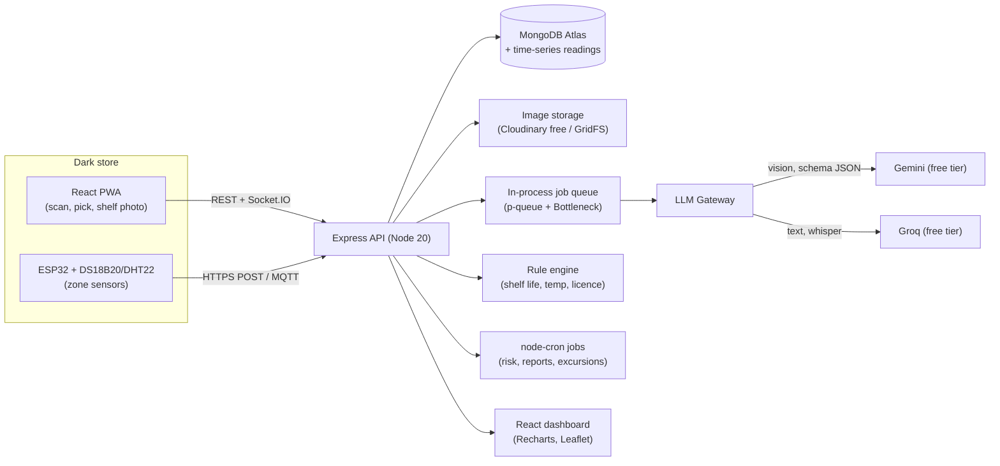

# FreshWarden — The Guardian on Every Shelf

> **Fresh** + **Warden**: a warden keeps watch, enforces the rules, and stops anything unsafe from getting through.
> A self-correcting food-safety operating system for quick-commerce dark stores.
> Stack: **MERN, plain JavaScript (no TypeScript)** · LLMs: **Gemini (vision) + Groq (fast text/audio), free tiers only**

---

## 0. Read this first (honest status check)

| Item | What I found | What you should do |
|---|---|---|
| Challenge name | The Fundizr blog calls it the "FSI Challenge". The official listing (Internshala / StartupGrants India) calls it **Zepto Nova**, run by Zepto with DPIIT and FSSAI. Theme: *"Smart Food Safety: AI, Automation & No Human Error"*. | Use both names when searching. |
| Deadline | Listings show applications ran **7 Jun – 7 Jul 2026**, with results on **30 Sep 2026**. Today is 20 Oct 2026. Startup-grant aggregators say it is **closed**. | Check the official Zepto Nova / Startup India page and email the organisers to see whether a later round exists. If not, build this as a **portfolio and pilot product**, and pitch it directly to dark-store operators and food-safety consultants. The plan works either way. |
| Prize | Fundizr says **₹5 lakh** plus a pilot across 1,100+ dark stores. Other listings say **₹1–3 lakh**, with a 3rd prize of ₹1 lakh. | Treat the ₹5 lakh figure as unverified. The pilot access is the real prize. |
| Eligibility | DPIIT-recognised (or in the process of getting it), early-stage startups, MSMEs, academic and research teams with a **deployable prototype**. | Start DPIIT recognition now. It is free and takes about a week. |
| Free-tier caveat | Gemini and Groq free tiers are for **prototyping**. Google's free tier may use your prompts for training and excludes commercial use. Free-tier limits change often. | Use only test photos, never real customer data. Plan the move to a paid tier before any real pilot (see §15). |

**How I used your two PDFs**
- **Fundizr/Zepto PDF** supplies the problem and the 9 solution areas Zepto wants (expiry detection, smart monitoring, temperature tracking, predictive risk, automated compliance, quality grading, spoilage detection, shelf-life prediction, automated sorting and quality control). Every module below maps to those.
- **FuncMatch PDF** (different problem, same hackathon mindset) supplies the *structure that wins*: a measurable "fingerprint", a closed learning loop, honest validation with real measurements, a hard-questions list, and a timed pitch. I reuse that structure here, so you get a **Safety Fingerprint** per SKU instead of a Function Fingerprint.

---

## 1. Problem understanding

**What actually goes wrong** (from the Zepto PDF plus news and regulator coverage):

- Dark-store inspections in 2025 found fungal growth on food, **expired stock mixed with fresh stock**, cold storage outside the legal range, food on wet floors, and storage next to stagnant water. Maharashtra FDA suspended the licence of Zepto's Dharavi facility; a Blinkit store in Pune was stopped from handling food for having no licence.
- A former employee's Reddit post (r/pune, widely re-reported) alleged that expired items were sent out because the stock was low. Treat this as an allegation, but it shows the failure mode: **the pressure of 10-minute delivery beats the checks**.
- Rule that matters: FSSAI's advisory for e-commerce food operators requires **at least 30% shelf life remaining, or at least 45 days to expiry, at the time of delivery**. It also requires food and non-food items to be delivered separately and delivery staff to be trained in hygiene.
- FSSAI reportedly inspected 8,143 e-commerce storage facilities and issued notices to 526 (about 6.5%) for violations.
- Scale: Zepto runs about 1,100+ dark stores. Manual checks cannot be perfect at that scale, because people are rushed, tired, and unobserved.

**The real insight:** reporting problems is not enough, because humans miss them. The system must **block the error at the moment it would happen**: at inward, at shelf, at pick, at pack. That is what "No Human Error" means.

---

## 2. What already exists (research) and the gaps

> Research done on 20 Oct 2026 via web search. **I could not search Discord servers** (not indexed) and Reddit coverage came mainly through news write-ups. Section 16 lists communities to check manually.

### 2.1 Existing solutions

| Category | Examples found | What they do well | Gap for dark stores |
|---|---|---|---|
| Open-source expiry-date readers | HuggingFace "Expiry_Date_Detection" (YOLOv8 + OCR); Tohoku G-RIPS 2025 report (YOLO + EasyOCR/PaddleOCR + regex on carton boxes); Brazilian YOLO study (668-image dataset, F1 0.81); Flipkart Grid robotics entry (YOLOv8 + EasyOCR + freshness classifier + barcode lookup) | Show the pipeline works: detect the date region, OCR it, parse it with regex | Stop at "here is a date". No FSSAI rule check, no batch or FEFO logic, no action, no evidence trail. Papers note accuracy is limited by small datasets and messy printing (inkjet, curved packs, glare). |
| Retail shelf-audit vendors | Pensa Systems, Simbe, Focal Systems, Trigo, Shelfie, Retail Scan (Mumbai), ShelfSight-style startups | Out-of-stock, planogram and share-of-shelf detection | Built for **availability and merchandising**, not **safety and compliance**. Expiry visibility is a side feature. Fixed cameras and robots are costly for 1,100+ small stores. |
| FEFO service providers | Channelplay-type merchandising services | Human merchandisers enforce First-Expiry-First-Out | Manual, periodic, not real-time. Cannot audit every shelf daily. |
| DIY cold-chain IoT | GitHub: ChillControl (ESP32, door-open count, buzzer), ESP32 + MQTT + Telegraf + InfluxDB + Grafana stacks, Node-RED dashboards | Prove cheap sensors (about ₹500 per node) are enough | Alerts only. They do not know **which products** sat in the warm zone, **how much shelf life was lost**, or what to do next. |
| Regulator and platform programs | Zepto Sankalp (training and awareness), FSSAI hygiene ratings | Culture and training | Training does not stop an error at the moment it happens. |

### 2.2 What FreshWarden adds (our edge)

| # | Improvement | Why it matters |
|---|---|---|
| 1 | **Rule engine, not just OCR.** Extracted dates feed a configurable FSSAI rule engine (30% / 45-day, licence presence, storage temperature). | Turns "a date was read" into "accept, quarantine, or reject, and why". |
| 2 | **Closed-loop blocking** at 4 gates: inward, shelf, pick, pack. | Delivers the "no human error" promise. |
| 3 | **Thermal shelf-life debit.** Every temperature excursion reduces the remaining shelf life of the lots stored in that zone. | Links the IoT data to the actual products. Existing DIY projects stop at the alert. |
| 4 | **Tiered AI routing:** barcode → on-device OCR → Gemini vision only when needed → human check. | Keeps cost and latency low and fits inside free-tier limits. |
| 5 | **Evidence chain.** Every decision stores photo, hash, timestamp, store, user and rule version. | Makes the system "raid-ready" for inspectors. |
| 6 | **Compliance Autopilot.** Daily checklists and audit PDFs generated from real sensor and vision evidence, summarised by Groq. | Replaces paper registers that can be faked. |
| 7 | **Offline-first PWA for ₹8,000 phones**, Hindi and English UI. | Real store staff use cheap Android phones on weak Wi-Fi. |
| 8 | **Human-in-the-loop with active learning.** Low-confidence reads go to a supervisor; corrections feed the evaluation set. | The FuncMatch lesson: show the learning loop. |
| 9 | **Honest metrics.** We measure false-accept rate (expired item accepted), the most dangerous error, on a labelled photo set. | Judges and pilots trust measured numbers. |

---

## 3. Product definition

**One line:** *FreshWarden watches every pack from the dock to the doorstep, and refuses to let an unsafe item move forward.*

### 3.1 The Safety Fingerprint (adapted from FuncMatch's "Function Fingerprint")

Every SKU and every lot carries the same measurable vector:

| Dimension | Metric | Source |
|---|---|---|
| Freshness | Remaining shelf-life % and days | Label read + rule engine |
| Thermal | Required zone (ambient / chilled / frozen), minutes outside the legal range, thermal debit | Sensors |
| Labelling | MRP, MFG/EXP, batch, FSSAI licence number present and readable | Vision |
| Hygiene | Floor contact, pests, damp, packaging damage, segregation | Vision |
| Provenance | Vendor, GRN id, inward photo, who and when | System |
| Risk | 0–100 spoilage and compliance risk score | Model |

### 3.2 Modules mapped to Zepto's 9 asks

| Zepto/FSI ask (from the PDF) | FreshWarden module | Phase |
|---|---|---|
| AI-based expiry date detection | **Inward Gate** (barcode → OCR → Gemini) | 2 |
| Automated compliance monitoring | **Compliance Autopilot** + rule engine | 1, 6 |
| Temperature and humidity tracking | **Cold-Chain Pulse** (ESP32 sensors) | 3 |
| Smart food-safety monitoring (AI cameras, IoT) | **Shelf Sentinel** | 4 |
| Spoilage and contamination detection | Shelf Sentinel hygiene and damage checks | 4 |
| Predictive risk detection | **Risk Engine** (shelf life, thermal debit, sales velocity) | 3, 6 |
| Shelf-life prediction | Thermal shelf-life debit | 3 |
| Quality grading and inspection (fruits, veg, eggs) | **FreshGrade** (stretch) | 8 |
| Automated sorting and quality control | **Dispatch Guard** (pick/pack veto, FEFO pick path) | 5 |

### 3.3 Users and screens

| Role | Device | Core screens |
|---|---|---|
| Dock staff / receiver | Phone PWA | Scan pack → verdict (green / amber / red) → place in zone |
| Picker / packer | Phone PWA | Scan to pick → veto with reason → food / non-food bag reminder |
| Store manager | Phone / laptop | Today's risk list, open incidents, shelf-scan tasks, temperature status |
| Area / network head | Laptop | Heatmap of all stores, trends, repeat offenders |
| Inspector (read-only) | Shared link | Evidence timeline and audit PDF |

---

## 4. Architecture



### 4.1 Tiered verification pipeline (the cost and speed trick)

```
Pack photo
  1. Barcode (EAN-13) decode in browser  → catalog hit gives product, shelf-life days, MRP
  2. On-device OCR (Tesseract.js) on the cropped date region → regex parse
        confidence high and date sane?  → DONE (no LLM call)
  3. Else → Gemini vision with JSON schema (label fields + confidence)
  4. Else (Gemini fails / rate-limited) → Groq vision model fallback (if available) → else
  5. Human check: supervisor sees the photo and types the date (becomes a labelled sample)
```

Rule: **a date is never auto-accepted unless two signals agree** (for example OCR and Gemini, or the label date and the catalog shelf-life). Otherwise it goes to amber.

### 4.2 Free-tier budget (verify current numbers in AI Studio and Groq console)

| Provider | Reported free limits (2026 sources, may change) | How we stay inside |
|---|---|---|
| Gemini (Flash / Flash-Lite only; Pro is paid) | About 15 requests/min and 1,500/day on Flash; Gemini 2.5 models were scheduled to shut down on 16 Oct 2026, so **do not hardcode model names** | Tiered pipeline (most scans never reach Gemini), image-hash cache, queue with rate limiter, model name in `.env` |
| Groq | About 30 requests/min on most models; daily caps vary by model, one source lists 1,000–14,400 requests/day; Whisper has a free tier | Use for text only (summaries, classification, translation, voice notes), cache outputs |

Demo scale: 1 store, a few hundred scans/day fits. Network scale needs a paid tier. Say this openly in the pitch.

---

## 5. Tech stack (JavaScript only)

| Layer | Choice |
|---|---|
| Frontend | React 18 + **Vite** (`.jsx`), React Router, TanStack Query, Tailwind CSS, Recharts, Leaflet, `socket.io-client`, `vite-plugin-pwa`, `@zxing/browser` (barcode), `tesseract.js` (OCR), `i18next` (en/hi), `react-webcam` or native `<input capture>` |
| Backend | Node 20, Express, Mongoose, **Zod** (validation, works in plain JS), `jsonwebtoken`, `bcryptjs`, `helmet`, `express-rate-limit`, `multer` (memory storage) + `sharp` (compress and hash), `socket.io`, `node-cron`, `p-queue` + `bottleneck`, `pdfkit`, `pino`, `mqtt` (optional) |
| DB | MongoDB Atlas M0 (free). Time-series collection for sensor readings with a TTL. |
| LLM SDKs | `@google/genai` (Gemini), `groq-sdk` (Groq) |
| IoT | ESP32 DevKit + DS18B20 (temperature) + DHT22 (humidity) + optional reed switch (door open). HTTPS POST or MQTT (Mosquitto in Docker). |
| Tests | Vitest (frontend), Jest + Supertest + `mongodb-memory-server` (backend) |
| DevOps | Docker Compose, GitHub Actions (lint, test, build), Render/Railway (API), Vercel/Netlify (web), `.env` per environment |
| Code rules | ESM modules, ESLint + Prettier, JSDoc comments for types, **no `.ts` files, no `tsconfig`** |

### 5.1 Repo structure

```
annadrishti/
├─ apps/
│  ├─ web/                    # React PWA + dashboard
│  │  └─ src/{pages,components,hooks,lib,i18n,store}/
│  └─ api/
│     └─ src/
│        ├─ config/           # env, db, logger
│        ├─ models/           # Mongoose schemas
│        ├─ modules/
│        │   ├─ auth/ stores/ catalog/ inward/ shelf/ coldchain/
│        │   ├─ dispatch/ incidents/ reports/ risk/
│        ├─ rules/            # shelfLife.js, temperature.js, licence.js (pure functions)
│        ├─ llm/              # gateway.js, gemini.js, groq.js, prompts/, schemas/, cache.js
│        ├─ jobs/             # cron: excursions, risk, daily report
│        ├─ middleware/       # auth, rbac, error, rateLimit
│        └─ server.js
├─ tools/
│  ├─ sensor-simulator/       # Node script that fakes ESP32 readings for demos
│  └─ eval/                   # scripts to score label-reading accuracy
├─ firmware/esp32/            # Arduino sketch
├─ datasets/                  # labelled photos + ground truth CSV (not committed if large)
├─ docs/                      # this file, API spec, pitch
├─ docker-compose.yml
└─ .github/workflows/ci.yml
```

### 5.2 `.env.example`

```
# API
PORT=5000
MONGO_URI=mongodb+srv://...
JWT_SECRET=change-me
CLIENT_ORIGIN=http://localhost:5173
# LLMs (free tiers). Model names live here because they change often.
GEMINI_API_KEY=
GEMINI_VISION_MODEL=            # a current Flash / Flash-Lite model from AI Studio
GROQ_API_KEY=
GROQ_TEXT_MODEL=llama-3.3-70b-versatile   # confirm still listed in the Groq console
GROQ_WHISPER_MODEL=whisper-large-v3-turbo # confirm in console
LLM_MAX_RPM_GEMINI=12           # stay under the provider limit
LLM_MAX_RPM_GROQ=25
# Storage
CLOUDINARY_URL=
# IoT
DEVICE_SHARED_SECRET=change-me
```

---

## 6. Data model (Mongoose collections)

| Collection | Key fields |
|---|---|
| `Store` | name, city, location {lat,lng}, fssaiLicenceNo, zones[] {id, type: ambient/chilled/frozen, limits {minC,maxC}} |
| `User` | name, role (receiver, picker, manager, area, inspector, admin), storeIds[], language, passwordHash |
| `Product` | barcode (unique), name, brand, category, shelfLifeDays (default), storageType, allergens[], fssaiLicenceNoVendor |
| `Lot` | storeId, productId, batchNo, mfgDate, expDate, qty, zoneId, status (`accepted`, `quarantine`, `rejected`, `dispatched`, `discarded`), effectiveExpDate (after thermal debit), evidenceIds[], vendorId |
| `InwardRecord` | storeId, lotId, userId, imageId, extracted {fields, confidence, source: barcode/ocr/gemini/manual}, verdict {status, reasons[]}, ruleVersion |
| `ShelfScan` | storeId, zoneId, imageId, findings[] {type, severity, bbox?, note}, score, reviewedBy |
| `Sensor` | storeId, zoneId, deviceId, type, lastSeenAt |
| `Reading` (time-series) | ts, sensorId, zoneId, tempC, humidity, doorOpen |
| `Excursion` | zoneId, startedAt, endedAt, peakC, minutesOutside, affectedLotIds[], debitDays, status |
| `DispatchCheck` | orderId, storeId, userId, items[] {lotId, verdict, reasons[]}, foodNonFoodSplit, ts |
| `Incident` | storeId, type, severity, sourceRef, owner, status, capa {action, dueAt, closedAt, proofImageId} |
| `Evidence` | storeId, kind, sha256, url, takenAt, takenBy, gps?, meta |
| `AuditReport` | storeId, period, pdfUrl, summary, scoreBreakdown, generatedAt |
| `Rule` | key, version, params (JSON), effectiveFrom, notes |
| `LlmCall` | provider, model, purpose, tokensIn/out, latencyMs, cacheHit, ok, error |

---

## 7. API contract (v1)

```
POST   /api/auth/login                       GET /api/me
GET    /api/stores/:id/overview              (risk list, temp status, open incidents)

POST   /api/catalog/lookup {barcode}         → product or 404
POST   /api/inward/verify  (multipart: image, barcode?, zoneId)
       → { verdict: green|amber|red, reasons[], extracted{}, lot? , needsHuman }
POST   /api/inward/:id/human-confirm {fields}  (supervisor correction, becomes labelled sample)

POST   /api/shelf/scan     (multipart: image, zoneId)  → { findings[], score }

POST   /api/telemetry      (device, header x-device-key) {deviceId, zoneId, tempC, humidity, doorOpen}
GET    /api/zones/:id/readings?from&to
GET    /api/zones/:id/excursions

POST   /api/dispatch/check {orderId, items:[{barcode|lotId}]} → per-item verdict + FEFO suggestion
POST   /api/dispatch/pack  {orderId, foodBag, nonFoodBag}

GET    /api/incidents        POST /api/incidents        PATCH /api/incidents/:id/capa
GET    /api/reports/daily?storeId&date     → PDF
GET    /api/inspector/:token               (read-only evidence view)
POST   /api/voice/incident (audio)         → Groq Whisper → structured incident
```

Socket.IO events: `zone:alert`, `lot:status`, `dispatch:veto`, `incident:new`.

---

## 8. Core logic (write these as pure, well-tested functions)

### 8.1 Shelf-life rule engine (`rules/shelfLife.js`)

```js
// Rule params live in the Rule collection so the compliance team can change them.
// FSSAI advisory: >=30% shelf life remaining OR >=45 days before expiry at delivery.
// VERIFY the exact wording and any category exceptions with the FSSAI notice / a mentor.
export const DEFAULT_RULE = { minPercent: 30, minDays: 45, mode: 'either', warnPercent: 40 };

const DAY = 86_400_000;

export function evaluateShelfLife({ mfgDate, expDate, now = new Date(), rule = DEFAULT_RULE }) {
  const reasons = [];
  if (!expDate) return { status: 'amber', reasons: ['EXPIRY_NOT_READ'], remainingPct: null, remainingDays: null };
  const exp = new Date(expDate);
  const remainingDays = (exp - now) / DAY;
  if (remainingDays <= 0) return { status: 'red', reasons: ['EXPIRED'], remainingPct: 0, remainingDays };

  let remainingPct = null;
  if (mfgDate) {
    const total = (exp - new Date(mfgDate)) / DAY;
    if (total > 0) remainingPct = (remainingDays / total) * 100;
    else reasons.push('MFG_AFTER_EXP_CHECK_LABEL');
  }
  const passPct = remainingPct !== null && remainingPct >= rule.minPercent;
  const passDays = remainingDays >= rule.minDays;
  const pass = rule.mode === 'either' ? (passPct || passDays) : (passPct && passDays);

  if (remainingPct === null) reasons.push('MFG_UNKNOWN_PERCENT_NOT_CHECKED');
  if (!pass) return { status: 'red', reasons: [...reasons, 'BELOW_MIN_SHELF_LIFE'], remainingPct, remainingDays };
  if (remainingPct !== null && remainingPct < rule.warnPercent) reasons.push('NEAR_THRESHOLD');
  return { status: reasons.length ? 'amber' : 'green', reasons, remainingPct, remainingDays };
}

// Indian labels often print "EXP 12/2026" (month-year). Treat as END of that month.
export function parseLabelDate(text) { /* regex for DD/MM/YYYY, DD-MM-YY, MMM YYYY, MM/YYYY, "BEST BEFORE 6 MONTHS FROM MFG" */ }
```

### 8.2 Thermal shelf-life debit (`rules/temperature.js`)

```js
// Heuristic: spoilage rate roughly multiplies by Q10 for every +10C above the reference.
// NOT scientifically validated per category. Label it "estimated" in the UI and calibrate later.
export function thermalDebitDays({ readings, refC, q10 = 2 }) {
  let debit = 0;
  for (let i = 1; i < readings.length; i++) {
    const dtDays = (readings[i].ts - readings[i - 1].ts) / 86_400_000;
    const t = readings[i].tempC;
    if (t > refC) debit += (Math.pow(q10, (t - refC) / 10) - 1) * dtDays;
  }
  return debit; // days to subtract from effectiveExpDate
}
```

Excursion detection: temperature outside the zone limits for more than N minutes (default 10) opens an `Excursion`, lists affected lots, computes the debit, re-runs `evaluateShelfLife` with `effectiveExpDate`, and flips lots to amber or red. Door-open flag lowers false alarms (a short spike right after a door opening is amber, not red).
**Default zone limits are configurable placeholders; confirm the legal numbers for each category with FSSAI Schedule 4 and your mentor before you show them as "compliant".**

### 8.3 Risk score (v1, explainable, no black box)

```
risk = 40*(1 - remainingPct/100) + 25*thermalExposureNorm + 20*(velocityLow ? 1 : 0)
     + 10*(hygieneFindingsNorm) + 5*(labelUncertain ? 1 : 0)
```
Show the top 3 contributors in the UI. Later, calibrate on real outcomes with a simple logistic regression (data-science angle) once you have data.

### 8.4 LLM gateway (`llm/gateway.js`) — skeleton

```js
import { GoogleGenAI, Type } from '@google/genai';
import Groq from 'groq-sdk';
import Bottleneck from 'bottleneck';
import crypto from 'node:crypto';
import { LlmCall } from '../models/LlmCall.js';

const gemini = new GoogleGenAI({ apiKey: process.env.GEMINI_API_KEY });
const groq = new Groq({ apiKey: process.env.GROQ_API_KEY });
const gLimiter = new Bottleneck({ minTime: Math.ceil(60000 / +process.env.LLM_MAX_RPM_GEMINI), maxConcurrent: 2 });
const qLimiter = new Bottleneck({ minTime: Math.ceil(60000 / +process.env.LLM_MAX_RPM_GROQ), maxConcurrent: 2 });
const cache = new Map(); // swap for a Mongo-backed cache with TTL

export async function extractFromImage({ buffer, mimeType, prompt, schema, purpose }) {
  const key = crypto.createHash('sha256').update(buffer).update(purpose).digest('hex');
  if (cache.has(key)) return { ...cache.get(key), cacheHit: true };
  const t0 = Date.now();
  try {
    const res = await gLimiter.schedule(() =>
      gemini.models.generateContent({
        model: process.env.GEMINI_VISION_MODEL,
        contents: [{ role: 'user', parts: [
          { inlineData: { mimeType, data: buffer.toString('base64') } },
          { text: prompt },
        ]}],
        config: { responseMimeType: 'application/json', responseSchema: schema, temperature: 0 },
      }));
    const data = JSON.parse(res.text);
    cache.set(key, { data, provider: 'gemini' });
    await LlmCall.create({ provider: 'gemini', purpose, latencyMs: Date.now() - t0, ok: true });
    return { data, provider: 'gemini' };
  } catch (err) {
    await LlmCall.create({ provider: 'gemini', purpose, latencyMs: Date.now() - t0, ok: false, error: String(err) });
    return { data: null, provider: 'none', needsHuman: true, error: String(err) }; // never guess
  }
}

export async function textTask({ system, user, json = false, purpose }) {
  const res = await qLimiter.schedule(() =>
    groq.chat.completions.create({
      model: process.env.GROQ_TEXT_MODEL,
      temperature: 0.2,
      messages: [{ role: 'system', content: system }, { role: 'user', content: user }],
      ...(json ? { response_format: { type: 'json_object' } } : {}),
    }));
  return res.choices[0].message.content;
}
// Check current SDK docs for exact schema helpers (Type enum / responseJsonSchema) before coding.
```

### 8.5 ESP32 firmware (HTTP, simplest path)

```cpp
// firmware/esp32/main.ino  (Arduino C++ is fine: it is firmware, not the web app)
#include <WiFi.h>
#include <HTTPClient.h>
#include <OneWire.h>
#include <DallasTemperature.h>
OneWire oneWire(4); DallasTemperature ds(&oneWire);
const char* API = "https://YOUR_API/api/telemetry";
void setup(){ Serial.begin(115200); WiFi.begin("SSID","PASS"); ds.begin(); }
void loop(){
  ds.requestTemperatures(); float t = ds.getTempCByIndex(0);
  HTTPClient http; http.begin(API);
  http.addHeader("Content-Type","application/json");
  http.addHeader("x-device-key","DEVICE_SHARED_SECRET");
  String body = String("{\"deviceId\":\"esp-01\",\"zoneId\":\"chiller-1\",\"tempC\":") + t + "}";
  http.POST(body); http.end();
  delay(30000);  // 30 s; buffer readings in RAM if Wi-Fi drops
}
```

No hardware yet? Use `tools/sensor-simulator` (Node) to publish readings, including a scripted "door left open" excursion for the demo.

---

## 9. Phase-wise plan

> Timeline assumes a solo or two-person student team. **Do not skip the acceptance checks.** If time is tight, use the **7-day MVP cut** at the end of this section.

### Phase 0 — Setup and research lock (Days 1–2)
**Goal:** a repo that builds, deploys, and has CI from day one.
- Create monorepo, ESLint/Prettier, Husky pre-commit, Vite app, Express app, Atlas M0, Cloudinary, GitHub Actions (lint + test).
- Get Gemini and Groq keys. Confirm current model names and limits in each console and put them in `.env`.
- Start DPIIT recognition (if you plan to pitch to Zepto or investors).
- Collect **30 real pack photos** from your kitchen and nearby shops (varied printing, curved packs, glare) as the seed of the evaluation set.
- **Deliverable:** deployed "hello" API and web app, CI green.
- **Acceptance:** `git push` triggers tests; the deployed web app calls the deployed API.

### Phase 1 — Core platform and rule engine (Days 3–7)
**Goal:** auth, stores, catalog, rules, tests.
- Models, JWT auth with role-based access, store and zone setup, product catalog seeding (CSV import of 100–200 common SKUs with default shelf-life days).
- Implement `evaluateShelfLife`, `parseLabelDate`, `thermalDebitDays` as pure functions with at least 30 unit tests (month-year dates, leap years, missing MFG, two-digit years, "6 months from MFG").
- Rule collection with versioning; every verdict stores `ruleVersion`.
- **Deliverable:** working API, seeded data, rule-engine test suite.
- **Acceptance:** ≥90% coverage on `rules/`; role access verified by tests.

### Phase 2 — Inward Gate (Week 2)
**Goal:** scan a pack and get a verdict in under about 5 seconds.
- PWA camera screen, barcode decode (zxing), crop-and-OCR (tesseract.js), tiered pipeline from §4.1, Gemini label extraction with JSON schema, confidence handling, amber flow to supervisor, human-confirm endpoint that stores corrected values.
- Lot creation with zone assignment and FEFO ordering (earliest effective expiry first).
- Image compression (sharp) and SHA-256 hash; store as Evidence.
- **Deliverable:** end-to-end inward demo with green, amber, red outcomes.
- **Acceptance:** on your 30-photo set, record date-read accuracy and the **false-accept count** (an expired or below-threshold item marked green). Target is **zero false accepts**; accept more amber to get there.

### Phase 3 — Cold-Chain Pulse (Week 3)
**Goal:** real or simulated temperature drives product status.
- Build the ESP32 node (DS18B20 + optional DHT22 and door switch) or use the simulator. Telemetry endpoint with device key, time-series storage, live chart via Socket.IO.
- Excursion detection, affected-lot lookup, thermal debit, automatic lot status change, push alert to the manager screen.
- Offline buffering on the device, "sensor silent for 5 minutes" alert (a dead sensor is a risk too).
- **Deliverable:** unplug-the-chiller demo: temperature rises, alert fires, lots turn amber/red, shelf life reduces.
- **Acceptance:** excursion detected within 1 minute of crossing the threshold in a test run; no false alarm on a 20-second door opening.

### Phase 4 — Shelf Sentinel (Week 4)
**Goal:** a shelf photo becomes a list of findings.
- Shelf photo capture per zone (guided: "photograph the top two rows"). Gemini prompt returns findings: visible expired or near-expiry labels, mixed batches, FEFO violation, items on floor, damaged or bulging packs, mould, pests, wet floor, open cartons.
- Findings create tasks with owner and due time; closing a task requires a proof photo (CAPA).
- Scheduled reminders (cron) so every zone is scanned at set intervals; missed scans raise a flag.
- Privacy: instruct the model to ignore people; crop or blur faces on device if any appear.
- **Deliverable:** scan → findings → task → proof → closed loop.
- **Acceptance:** run on 40 staged shelf photos; report precision and recall per finding type in `docs/eval.md`.

### Phase 5 — Dispatch Guard (Week 5)
**Goal:** the last line of defence before the customer.
- Picker flow: scan item → check lot status, effective expiry at delivery time (add an ETA buffer, for example 15 minutes), zone temperature status, FEFO (suggest the right lot) → green or a hard veto with a plain reason in Hindi or English.
- Pack step: reminder and confirmation for separate food and non-food bags (FSSAI advisory).
- Every check logged to `DispatchCheck`; vetoes raise an incident when repeated.
- Target latency under 1.5 s p95 (no LLM in this path, only DB and rules).
- **Deliverable:** order simulation where an expired item is placed in the cart and the picker app blocks it.
- **Acceptance:** 100% of seeded bad lots blocked in a 50-order simulation; p95 latency recorded.

### Phase 6 — Compliance Autopilot and Command Center (Week 6)
**Goal:** the manager and inspector view.
- Store dashboard: temperature status, near-expiry list, open incidents, today's checklist auto-filled from evidence.
- Network dashboard: Leaflet map with a store health score colour (use seeded demo stores), trend lines, repeat-offender list.
- Daily audit PDF (pdfkit) with evidence thumbnails and rule versions; Groq writes a plain-language summary and a prioritised to-do list (the model only summarises data we pass in; it never invents numbers).
- Inspector read-only link with expiry.
- Risk engine v1 (§8.3) with explanations.
- **Deliverable:** "raid-ready" button that produces a PDF and a read-only link in under 10 seconds.
- **Acceptance:** every number in the PDF traces to a database record; check manually on 10 samples.

### Phase 7 — Hardening, evaluation, and pilot pack (Week 7)
**Goal:** production-realistic, not tutorial-grade.
- Security: input validation (Zod), rate limits, helmet, device-key rotation, role checks, upload type and size limits, secrets only in env.
- Reliability: structured logs (pino), health endpoint, retry with backoff for LLM calls, graceful degradation (LLM down means manual entry still works), Mongo indexes.
- Offline-first PWA: queue scans and sync later; test on a low-end Android phone with throttled network.
- CI/CD: GitHub Actions runs lint, tests, build, then deploys; preview deploys per pull request.
- Evaluation: grow the photo set to **200 labelled images**; publish a table of date-read accuracy, false-accept rate, amber rate, latency (p50/p95) and the share of scans that needed Gemini.
- Pilot pack: one-page onboarding guide, Hindi quick-start, data-privacy note, ROI worksheet.
- **Acceptance:** all metrics in `docs/eval.md` are measured, not estimated.

### Phase 8 — Stretch (Week 8+)
- **FreshGrade:** produce, eggs and bakery quality grading (colour, bruising, mould) with Gemini plus a simple score; compare against a human grader on 50 items.
- **Voice incident logging:** worker speaks in Hindi, Groq Whisper transcribes, Groq structures it into an incident.
- **Demand-aware risk:** weight risk by sales velocity (use synthetic or partner data).
- **Donation and return routing:** near-expiry stock routed to return-to-vendor, discard, or donation partners. Note that FSSAI's delivery rule limits what can be sold, so avoid markdown selling of stock below the legal threshold.

### The 7-day MVP cut (if you only have a week)
Days 1–2: Phase 0 + rule engine. Days 3–4: Inward Gate with barcode + Gemini (skip Tesseract). Day 5: simulated Cold-Chain Pulse with excursion → lot status. Day 6: Dispatch Guard veto. Day 7: dashboard, demo video, pitch. Skip Shelf Sentinel, PDF reports, and the PWA offline mode, and say so openly.

---

## 10. MASTER PROMPT (paste this into any coding LLM at the start of a session)

Use this with Claude, ChatGPT, Gemini, Cursor, Copilot, or any model. Then paste the **phase prompt** from §11 for the phase you are working on.

````
You are a senior full-stack engineer and my pair-programmer. We are building "FreshWarden",
a food-safety operating system for quick-commerce dark stores in India (Zepto-style, 1,100+ stores).

## Hard constraints
- Stack: MERN. MongoDB (Mongoose), Express, React 18 (Vite), Node 20.
- Language: PLAIN JAVASCRIPT ONLY. No TypeScript, no .ts/.tsx files, no tsconfig. Use ES modules.
  Use JSDoc comments where types would help. Use Zod for runtime validation (it works in JS).
- LLMs: free tiers only. Gemini (package @google/genai) for anything involving IMAGES.
  Groq (package groq-sdk) for fast text tasks, classification, summaries, translation, and Whisper audio.
  Model names come from environment variables (GEMINI_VISION_MODEL, GROQ_TEXT_MODEL, GROQ_WHISPER_MODEL).
  NEVER hardcode a model name. All LLM calls go through ONE gateway module (src/llm/gateway.js) with:
  rate limiting (Bottleneck), SHA-256 image-hash caching, structured JSON output via schema,
  logging to an LlmCall collection, and graceful failure. If an LLM fails or is unsure, return
  needsHuman=true. NEVER guess a date or invent a value.
- Free-tier limits are small (about 15 requests/min on Gemini Flash, about 30/min on Groq). Design a tiered
  pipeline: barcode -> on-device OCR (tesseract.js) -> Gemini only if needed -> human confirm.
- No paid services. Free options: MongoDB Atlas M0, Cloudinary free, Render/Railway, Vercel, GitHub Actions.

## Product
Four gates where unsafe items must be stopped (the system BLOCKS, it does not only report):
1. Inward Gate: scan a pack, read batch/MFG/EXP/FSSAI no., run the rule engine, give a green/amber/red verdict.
2. Cold-Chain Pulse: ESP32 temperature/humidity sensors per zone -> excursion detection -> thermal shelf-life
   debit on affected lots -> automatic status change and alerts.
3. Shelf Sentinel: shelf photos -> Gemini findings (expired/near-expiry, mixed batches, FEFO violations,
   floor contact, mould, pests, damage) -> tasks with proof-photo closure (CAPA).
4. Dispatch Guard: pick/pack veto using lot status, effective expiry at delivery, zone temperature,
   FEFO; separate food/non-food bag confirmation.
Plus: Compliance Autopilot (daily checklist + audit PDF + read-only inspector link) and a Command Center
dashboard (store health map, risk list). Optional later: FreshGrade (produce quality), voice incidents.

## Regulatory logic (configurable, versioned in a Rule collection, flagged "verify with FSSAI")
- E-commerce food delivery must have >=30% shelf life remaining OR >=45 days to expiry at delivery.
  Implement as params {minPercent:30, minDays:45, mode:'either'|'both'}. Short-life items (bread) rely on the
  percent rule. Indian labels often show month-year ("EXP 12/2026") = end of that month.
- Food and non-food items must be packed/delivered separately.
- Temperature limits per zone are configurable placeholders; never present them as legally verified.

## Engineering standards
- Folder layout: apps/web (React PWA), apps/api (Express), tools/sensor-simulator, tools/eval, firmware/esp32.
- Pure functions for rules (src/rules/*.js) with Jest unit tests (aim >=90% coverage there).
- Controller -> service -> model layering. Zod validation on every request body. Central error handler.
- Security: helmet, rate limiting, JWT + RBAC (receiver, picker, manager, area, inspector, admin), file type/size limits,
  secrets only via env. Never log secrets or full images.
- Every verdict stores: ruleVersion, evidence id (image sha256), userId, timestamp, reasons[] (machine codes + human text).
- Offline-first PWA for low-end Android; i18n English + Hindi from day one (i18next).
- UI: mobile-first, big touch targets, green/amber/red verdicts with a one-line reason, minimal typing.
- Tests: Jest + Supertest + mongodb-memory-server (api), Vitest (web). CI via GitHub Actions: lint, test, build.
- Privacy: do not capture faces or monitor staff; blur/ignore people in images; store only product/shelf evidence.

## How you should work with me
1. Before coding, restate the task in 3-5 lines and list the files you will create or change.
2. Ask at most ONE clarifying question, only if truly blocking; otherwise state your assumption and proceed.
3. Output complete, runnable files (no "..." placeholders), with exact install commands and .env additions.
4. After the code, give: how to run it, how to test it, and 3 acceptance checks I can verify.
5. Prefer simple, explainable logic over clever logic. Flag any claim that needs real-world verification
   (legal limits, model limits, accuracy) instead of stating it as fact.
6. Keep each response focused on the current phase only. Do not build future phases early.
7. If a library API may have changed, say so and tell me which doc page to check.

## Definition of done for any task
Code runs locally, tests pass, no TypeScript, no hardcoded model names or secrets, errors handled,
mobile layout checked, and the acceptance checks listed.

Confirm you understand by replying with: (a) a 5-line summary of the product, (b) the exact folder tree
you will use, (c) any assumption you are making. Then wait for my phase prompt.
````

---

## 11. Detailed master prompt for each phase

How to use: open a **new chat** per phase. Paste the **Core Master Prompt (§10)** first, wait for the model's confirmation, then paste the phase prompt below. Each phase prompt also repeats the essential rules, so it still works if the model forgets §10. At the end of each phase, paste your repo tree and the failing test output (if any) into the same chat and ask for fixes.

---

### PHASE 0 — Foundation and scaffold

````
ROLE: Senior full-stack + DevOps engineer. Project: FreshWarden (food-safety OS for dark stores).
RULES THAT ALWAYS APPLY: MERN, PLAIN JAVASCRIPT ONLY (no TypeScript, no .ts/.tsx, no tsconfig), ES modules, Node 20.
LLMs only via src/llm/gateway.js (Gemini for images, Groq for text/audio), free tiers, model names from env, never guess values.
All thresholds live in a versioned Rule collection. Build ONLY this phase.

OBJECTIVE
Create a monorepo that installs, lints, tests, builds, runs locally with one command, and deploys, with CI green from the first commit.

REQUIREMENTS
1. Monorepo (npm workspaces): apps/web, apps/api, tools/sensor-simulator, tools/eval, firmware/esp32, docs, datasets.
2. apps/api: Express 4+, Mongoose, Zod, pino + pino-http, helmet, cors (origin from env), express-rate-limit, dotenv, jsonwebtoken, bcryptjs, multer, sharp.
   - src/config/env.js validates ALL env vars with Zod at startup and exits with a clear message if any are missing.
   - src/config/db.js connects to Mongo with retry/backoff; src/config/logger.js exports the pino logger.
   - src/middleware/error.js: central handler returning {error:{code,message,details?}}; map Zod errors to 400.
   - GET /health returns {status:'ok', uptimeSec, mongo:'up'|'down', version}.
   - src/server.js separate from src/app.js (so Supertest can import app without listening).
3. apps/web: Vite + React 18 (.jsx), Tailwind, react-router, TanStack Query, i18next (en + hi, with 5 sample keys),
   vite-plugin-pwa (manifest, icons placeholder, service worker registered), a layout with bottom nav for mobile, a Home page that calls /health and shows status.
4. Tooling: ESLint (flat config, plugin react + react-hooks, no-unused-vars error), Prettier, Husky + lint-staged pre-commit, .editorconfig, .gitignore (node_modules, .env, uploads).
5. docker-compose.yml: api, web (dev), mongo, mosquitto (MQTT optional). Provide Dockerfile for api and web.
6. GitHub Actions ci.yml: on push/PR -> setup-node 20 -> npm ci -> lint -> test -> build web. Cache npm.
7. Tests: one Jest+Supertest test for /health (use mongodb-memory-server), one Vitest test for the Home page.
8. README with: prerequisites, setup, scripts table (dev, lint, test, build, docker), env table, folder tree.
9. .env.example for api and web (list every variable with a comment; no real secrets).

EDGE CASES TO HANDLE: missing env var, Mongo down at startup (retry, health shows 'down'), CORS preflight, port already in use message.

DELIVERABLE FORMAT
(a) exact shell commands to create everything, (b) every file in full (no "..."), (c) how to run, (d) how to test, (e) 3 acceptance checks.

ACCEPTANCE CHECKS
- `npm run dev` starts web (5173) and api (5000); the Home page shows API status 'ok'.
- `npm test` passes; `npm run lint` has zero errors; CI workflow file is valid.
- Deleting a required env var makes the API exit with a readable error.

OUT OF SCOPE: auth, models, LLM code, any business logic.
````

---

### PHASE 1 — Core platform, data model, and rule engine

````
ROLE: Senior backend engineer with strong testing discipline. Project: FreshWarden. Build ONLY Phase 1 on top of the Phase 0 scaffold.
RULES THAT ALWAYS APPLY: MERN, PLAIN JAVASCRIPT ONLY, ES modules, Zod validation on every input, controller -> service -> model layering,
thresholds in a versioned Rule collection, every verdict stores ruleVersion + machine-readable reason codes.

OBJECTIVE
Authentication with roles, the core data model, catalog import, and a fully unit-tested pure-function rule engine.

1) MODELS (Mongoose, with indexes and timestamps)
Store{name,city,location{lat,lng},fssaiLicenceNo,zones[{zoneId,name,type:'ambient'|'chilled'|'frozen',limits{minC,maxC}}]}
User{name,phone,role:'receiver'|'picker'|'manager'|'area'|'inspector'|'admin',storeIds[],language:'en'|'hi',passwordHash}
Product{barcode(unique),name,brand,category,shelfLifeDays,storageType,allergens[],isFood:boolean}
Lot{storeId,productId,batchNo,mfgDate,expDate,effectiveExpDate,qty,zoneId,status:'accepted'|'quarantine'|'rejected'|'dispatched'|'discarded',evidenceIds[],createdBy}
Rule{key,version,params,effectiveFrom,notes}  (unique on key+version)
Evidence{storeId,kind,sha256,url,takenAt,takenBy,meta}
LlmCall{provider,model,purpose,tokensIn,tokensOut,latencyMs,cacheHit,ok,error}
Add compound indexes: Lot(storeId,status,effectiveExpDate), Product(barcode), Evidence(sha256).

2) AUTH + RBAC
POST /api/auth/login {phone,password} -> JWT (8h) ; GET /api/me ; middleware requireAuth, requireRole(...roles), requireStoreAccess.
Role rules: receiver (inward), picker (dispatch), manager (everything in own store), area (read many stores),
inspector (read-only via token later), admin (all). Passwords bcrypt cost 10. Login rate-limited (5/min/IP).

3) CATALOG
POST /api/catalog/import (admin, CSV upload) with row-level error report; GET /api/catalog/lookup?barcode=; seed script with 150 realistic Indian
grocery/dairy/bakery/frozen items (fake barcodes ok, realistic shelfLifeDays: bread 5, milk 3, curd 7, UHT milk 90, biscuits 180, ...).

4) RULE ENGINE (src/rules/*.js, pure functions, no DB access)
- shelfLife.js: evaluateShelfLife({mfgDate,expDate,now,rule}) as specified in the plan section 8.1. Statuses green/amber/red; reasons codes:
  EXPIRED, BELOW_MIN_SHELF_LIFE, NEAR_THRESHOLD, EXPIRY_NOT_READ, MFG_UNKNOWN_PERCENT_NOT_CHECKED, MFG_AFTER_EXP_CHECK_LABEL.
- parseLabelDate(text, {now}) -> {iso, precision:'day'|'month', confidence} handling: DD/MM/YYYY, DD-MM-YY, DD.MM.YYYY, "12 DEC 2026", "DEC 2026",
  "12/2026" (month-year = END of month), "EXP: 12/26", "BB 6 MONTHS FROM MFG" (needs mfgDate), 2-digit year pivot (00-69 => 2000s), reject impossible dates (31/02).
- temperature.js: thermalDebitDays({readings,refC,q10}) and detectExcursions({readings,limits,minMinutes,doorEvents}).
- fefo.js: sortFefo(lots) (earliest effectiveExpDate first, tie-break by createdAt).
- rules/index.js loads the active rule version from the DB (cached 60 s) and exposes getRule(key).

5) TESTS (Jest) - minimum 40 tests
Shelf life: exactly on 30%, just below 30%, 44 vs 45 days, 'either' vs 'both' modes, expired yesterday, expires today, MFG missing, MFG after EXP.
parseLabelDate: each format above, leap day 29/02/2028 valid and 29/02/2027 invalid, "EXP 12/2026" -> 2026-12-31, ambiguous 03/04/05 handled by day-first rule.
Excursions: 9 min above limit (no excursion), 11 min (excursion), door-open spike within 3 min ignored, sensor gap handling.
FEFO: equal expiry tie-break, missing dates last.
Auth/RBAC: wrong password, expired token, picker blocked from manager route, cross-store access denied.

EDGE CASES: timezones (store everything in UTC, compute day boundaries in Asia/Kolkata), invalid JSON, duplicate barcode on import, huge CSV (stream it).

DELIVERABLE FORMAT: files in full, install commands, run/test commands, sample curl requests, 3 acceptance checks.
ACCEPTANCE: >=90% coverage on src/rules; all RBAC tests pass; seed script creates 1 store, 3 zones, 5 users, 150 products; rule version is stored with every evaluation result.
OUT OF SCOPE: any LLM calls, image upload, frontend beyond a login page and a placeholder dashboard.
````

---

### PHASE 2 — Inward Gate (scan to verdict)

````
ROLE: Senior full-stack engineer with computer-vision pipeline experience. Project: FreshWarden. Build ONLY Phase 2 (Inward Gate).
RULES THAT ALWAYS APPLY: MERN, PLAIN JAVASCRIPT ONLY. All Gemini calls go through src/llm/gateway.js (rate limit, SHA-256 cache, JSON schema, LlmCall log).
Model name from process.env.GEMINI_VISION_MODEL. NEVER guess or invent a date. If unsure -> amber + needsHuman=true. Free-tier limits are small
(about 15 requests/min on Gemini Flash), so most scans must be resolved WITHOUT an LLM.

OBJECTIVE
A receiver scans a pack with a phone and gets a green/amber/red verdict with a one-line reason in under ~5 seconds, and a Lot is created with FEFO order.

PIPELINE (implement exactly)
Step 1 Barcode: @zxing/browser decodes EAN-13/EAN-8/UPC in the browser -> GET /api/catalog/lookup -> product + default shelfLifeDays.
Step 2 OCR: user taps 'Frame the date'; browser crops the date region (draggable box), preprocesses (grayscale, contrast, adaptive threshold via canvas),
         runs tesseract.js (eng), returns raw text + per-word confidence.
Step 3 Parse: parseLabelDate on OCR text; collect candidates {mfg, exp, bestBeforeText}.
Step 4 LLM fallback: if no parsable date OR confidence < 0.7 OR two conflicting dates -> upload the full image to POST /api/inward/verify;
         API calls Gemini (prompt in src/llm/prompts/labelExtract.js, schema: productName, brand, batchNo, mfgDate, expDate, bestBeforeText, mrp,
         fssaiNo, vegNonVegMark, confidence, fieldsUnreadable[], notes).
Step 5 Two-signal rule: auto-accept ONLY if two independent signals agree (OCR vs Gemini, or label EXP vs catalog shelfLife consistency:
         EXP - MFG within +/-20% of product.shelfLifeDays). Otherwise amber.
Step 6 Rules: evaluateShelfLife with the active rule; also check fssaiNo present (14 digits) and MRP present -> labelling reasons.
Step 7 Verdict {status, reasons[{code,text_en,text_hi}], extracted{}, sources{field:'barcode'|'ocr'|'gemini'|'manual'}, needsHuman, ruleVersion}.

API
POST /api/inward/verify (multipart: image, barcode?, ocrText?, zoneId) -> verdict + (if green or amber) a draft Lot.
POST /api/inward/:id/confirm {action:'accept'|'reject'|'quarantine', fields?} (receiver/manager); manager approval required for amber -> accept.
GET  /api/inward?storeId=&status= (list). Every call writes Evidence (sharp-compressed JPEG max 1280px, sha256, stored URL) and an InwardRecord.
Lot creation: assign zoneId from product.storageType, compute FEFO position, never allow a lot with status 'accepted' if verdict is red.

FRONTEND (mobile-first PWA, i18n en/hi)
Screens: ScanPage (camera, barcode overlay, 'Frame the date' step), VerdictCard (big green/amber/red, 1-line reason, remaining days and %, 'Place in Zone X'),
AmberReview (supervisor sees photo + extracted fields, edits dates, taps Confirm), Inward list. Show a spinner with step names ('Reading barcode', 'Reading date', 'Checking rules').
Compress images client-side before upload. Works with poor network: show retry, never lose a captured photo (IndexedDB queue stub is fine in this phase).

EVAL TOOLING
tools/eval/runInwardEval.js: reads datasets/inward/truth.csv (filename, expDate, mfgDate, expectedVerdict), runs the pipeline against each image,
outputs a table: date exact-match %, amber %, FALSE-ACCEPT count (expired/below-threshold marked green), share needing Gemini, p50/p95 latency.

TESTS: verify endpoint with mocked gateway (Gemini ok / Gemini fails / rate-limited), two-signal rule cases, red never auto-accepted, evidence hash stored,
RBAC (picker cannot confirm). Gateway test: same image twice -> second call is a cache hit.

EDGE CASES: glare/blur (photoQuality poor -> ask to retake), two dates on pack, month-year only, curved bottle, Hindi-only label, barcode not in catalog
(create product draft for manager review), duplicate scan of same lot (merge qty after confirm), camera permission denied.

DELIVERABLE FORMAT: files in full, install commands, .env additions, run/test steps, 3 acceptance checks.
ACCEPTANCE: on at least 30 real photos, zero false accepts; p95 under 6 s with Gemini and under 2 s without; every verdict traceable to an Evidence record.
OUT OF SCOPE: temperature, shelf photos, dispatch, PDFs.
````

---

### PHASE 3 — Cold-Chain Pulse (IoT, excursions, thermal debit)

````
ROLE: Embedded + backend engineer (ESP32, Node). Project: FreshWarden. Build ONLY Phase 3 (Cold-Chain Pulse).
RULES THAT ALWAYS APPLY: MERN, PLAIN JAVASCRIPT for web/API (Arduino C++ allowed only for ESP32 firmware). Thresholds come from Store.zones[].limits and the Rule
collection. Temperature limits are placeholders to be verified against FSSAI/Schedule 4 with a mentor; never label them 'legally compliant' in the UI.

OBJECTIVE
Sensor readings drive product status: a temperature excursion detects itself, finds affected lots, reduces their shelf life (thermal debit), changes status, and alerts.

1) TELEMETRY INGEST
POST /api/telemetry (header x-device-key, constant-time compare vs per-device secret) body {deviceId, zoneId, tempC, humidity?, doorOpen?, ts?}.
Validate with Zod (tempC between -40 and 80, reject NaN). Accept batches [{...}] to flush offline buffers. Idempotent on (deviceId, ts).
Store in a MongoDB time-series collection Reading (timeField ts, metaField {zoneId,deviceId}) with TTL 30 days. Update Sensor.lastSeenAt.
Optional MQTT subscriber (mqtt package) on topic freshwarden/+/telemetry feeding the same service function.

2) EXCURSION ENGINE (src/jobs/excursions.js, runs every 30 s plus on ingest)
Use detectExcursions from Phase 1: outside limits > minMinutes (default 10, configurable per zone); ignore spikes that start within 3 min of a doorOpen event;
close the excursion when back in range for 5 min. On open: create Excursion{zoneId,startedAt,peakC,minutesOutside}, find lots in that zone with status accepted,
emit Socket.IO 'zone:alert'. On close: compute thermalDebitDays with refC = zone max limit and q10 = Rule 'thermal.q10' (default 2), subtract from
each affected lot's effectiveExpDate, re-run evaluateShelfLife, update status (accepted->quarantine/rejected as needed), emit 'lot:status', write Incident for severity >= 2.
Silent-sensor alert: no reading for 5 min -> 'sensor:silent' incident (a dead sensor is a risk).

3) FIRMWARE (firmware/esp32/main.ino)
ESP32 + DS18B20 (GPIO4, 4.7k pull-up) + optional DHT22 + optional reed switch for door. Read every 30 s, POST JSON with the device key, ring-buffer up to
200 readings in RAM when Wi-Fi is down and flush as a batch, WiFi reconnect with backoff, watchdog, print status over Serial. Provide wiring table and BOM with approximate INR costs.

4) SIMULATOR (tools/sensor-simulator/index.js)
CLI: --zone chiller-1 --scenario normal|door-open|compressor-fail|sensor-dead --speed 60x. 'door-open' produces a 15-minute rise to 12C; 'compressor-fail' a slow climb.

5) FRONTEND
Zone page: live line chart (Recharts) with limit bands, status pill, door events, active excursion banner, affected-lots table showing original vs effective expiry and
'estimated' badge on the debit. Manager dashboard tile 'Zones OK / in excursion / silent'.

TESTS: ingest validation, idempotency, excursion open/close timing with fake timers, door-spike ignore, thermal debit numeric examples worked by hand,
lot status transitions, silent sensor, device-key auth.

EDGE CASES: clock drift (use server time if device ts is >5 min off), duplicate batches, sensor reading -127 (DS18B20 error code) discarded, Wi-Fi flaps, multiple zones per store.

DELIVERABLE FORMAT: files in full, wiring diagram in text, commands, 3 acceptance checks.
ACCEPTANCE: simulator 'compressor-fail' -> alert within 1 min of crossing limit; 20-second door opening raises no alert; lots in the zone change status after the debit;
unplugging the sensor produces a silent-sensor incident in 5-6 minutes.
OUT OF SCOPE: shelf photos, dispatch, PDF reports.
````

---

### PHASE 4 — Shelf Sentinel (shelf photos to findings to tasks)

````
ROLE: Full-stack engineer with computer-vision prompting experience. Project: FreshWarden. Build ONLY Phase 4 (Shelf Sentinel).
RULES THAT ALWAYS APPLY: MERN, PLAIN JAVASCRIPT ONLY. Images go ONLY to Gemini via src/llm/gateway.js; Groq is used only for text. Ignore and never describe people
in images; never score or identify staff. Model never guesses: low-confidence findings are labelled 'unverified'.

OBJECTIVE
A shelf or storage-area photo becomes structured findings, which become tasks with owners, due times and proof-photo closure, and missed scans are flagged.

1) CAPTURE + SCAN
POST /api/shelf/scan (multipart: image, zoneId, section?) -> compress, hash, store Evidence, call Gemini with prompts/shelfAudit.js and a strict JSON schema:
{photoQuality:'good'|'poor', poorReason?, findings:[{type, severity 1-3, note, confidence 0-1, region}], overallImpression}.
Types: EXPIRED_VISIBLE, NEAR_EXPIRY, MIXED_BATCH, FEFO_VIOLATION, FLOOR_CONTACT, MOULD, PEST, DAMAGED_PACK, WET_FLOOR, OPEN_CARTON, OTHER.
If photoQuality is poor -> return 'retake' with a tip (more light, hold steady, closer). Score = 100 - weighted severity (weights from Rule 'shelf.weights').
Cross-check: if a finding says EXPIRED_VISIBLE, try to match visible product to Lots in that zone and attach candidate lotIds (do not auto-change lot status; require manager confirm).

2) TASKS / CAPA
Each finding with confidence >= 0.6 creates an Incident{type, severity, owner (zone owner or manager), dueAt (sev3: 30 min, sev2: 4 h, sev1: 24 h)}.
PATCH /api/incidents/:id/capa {action, proofImageId} - closing requires a proof photo that is re-scanned (the same finding type must be absent) else it stays open.
Findings with confidence < 0.6 appear as 'unverified' for a human to confirm or dismiss; dismissals are stored as labelled negatives for the eval set.

3) SCHEDULING
Per-zone scan frequency in Rule 'shelf.scanEveryHours' (default 4 for chilled, 8 for ambient). node-cron job marks missed scans and raises a 'SCAN_MISSED' incident,
sends Socket.IO 'incident:new'. Show a 'next scan due' countdown on the store dashboard.

4) FRONTEND
Guided capture ('Photograph top two rows', outline overlay), result screen with annotated findings list (no bounding boxes required; region text is enough),
task inbox for managers, proof-photo upload, 'dismiss as false alarm' button, hi/en text.

5) EVAL
tools/eval/runShelfEval.js on datasets/shelf (images + truth.json): per-type precision/recall, photoQuality accuracy, average latency, Gemini calls per scan (must be exactly 1).

TESTS: schema validation of Gemini output (malformed JSON -> needsHuman), low-confidence handling, SLA due dates, CAPA closure requires proof, missed-scan cron with fake timers,
people-in-photo prompt rule (assert the prompt contains the privacy instruction), RBAC.

EDGE CASES: very dark photo, reflections on glass doors, duplicate photo submitted twice (cache hit, no new incident), 5 findings of the same type merged into one incident per zone, offline capture queue.

DELIVERABLE FORMAT: files in full, prompt file, schema file, commands, 3 acceptance checks.
ACCEPTANCE: on 40 staged photos, report precision/recall per type in docs/eval.md; every incident has an Evidence photo; closing without proof is rejected.
OUT OF SCOPE: object detection model training, dispatch, PDF.
````

---

### PHASE 5 — Dispatch Guard (pick and pack veto)

````
ROLE: Backend engineer focused on low-latency decision services plus a mobile UI. Project: FreshWarden. Build ONLY Phase 5 (Dispatch Guard).
RULES THAT ALWAYS APPLY: MERN, PLAIN JAVASCRIPT ONLY. NO LLM calls anywhere in this path (speed and reliability). Decisions use only DB state + the rule engine.

OBJECTIVE
Before an item is packed, the picker app confirms the exact lot is safe at the time of delivery; unsafe items are hard-blocked with a clear reason, and the correct older lot is suggested (FEFO).

1) DECISION SERVICE
POST /api/dispatch/check {orderId, etaMinutes?, items:[{barcode|lotId, qty}]} -> per item:
{lotId, verdict:'ok'|'warn'|'block', reasons[{code,text_en,text_hi}], suggestLotId?, remainingDays}.
Checks, in order: (a) lot status must be accepted; (b) effectiveExpDate vs now + etaMinutes + buffer (Rule 'dispatch.etaBufferMin', default 15) using evaluateShelfLife at delivery time;
(c) zone has no open excursion and sensor not silent; (d) FEFO: if an older eligible lot of the same product exists in the store, 'warn' with suggestLotId (block if Rule 'dispatch.enforceFefo' = true);
(e) quarantined/rejected/discarded lots always block; (f) unknown barcode -> block with 'UNKNOWN_ITEM'.
Return p95 < 1.5 s: single aggregation query per request, indexed fields only, projection of needed fields.

2) PACK STEP
POST /api/dispatch/pack {orderId, foodBagId, nonFoodBagId} - require both bag ids when the order mixes food (Product.isFood) and non-food items; stores DispatchCheck with split confirmation.
Override flow: a picker cannot override 'block'; a manager can override with a mandatory reason, logged as an Incident of type 'OVERRIDE'.

3) INCIDENT RULES
3 blocks on the same lot in 24 h -> auto-quarantine the lot and open an incident. Count blocks per store per day for the dashboard.

4) FRONTEND (picker PWA)
One screen: scan item -> giant green tick or red block (full-screen colour + vibration + sound), reason in the user's language, suggested lot location if FEFO warn,
progress bar of the order, 'bags' confirmation screen. Works with one hand, large buttons, no typing. Offline: use last-synced lot snapshot (IndexedDB) and mark the check 'offline' for later reconciliation.

5) SIMULATION
tools/eval/simulateOrders.js: generate 50 orders from seeded lots including 10 deliberately bad lots (expired, thermal-debited, quarantined, FEFO violation); report % blocked, false blocks, p50/p95 latency.

TESTS: each check branch, ETA boundary (expires 10 minutes after delivery), override permissions, auto-quarantine after 3 blocks, mixed-bag requirement, concurrency (two pickers, same last unit - qty decrement must be atomic with findOneAndUpdate).

EDGE CASES: lot qty zero, two lots with identical expiry, product without lots, clock skew, order edited mid-pick.

DELIVERABLE FORMAT: files in full, commands, benchmark instructions, 3 acceptance checks.
ACCEPTANCE: 100% of seeded bad lots blocked; zero false blocks on good lots; p95 latency under 1.5 s; no LLM import in src/modules/dispatch (add a test that fails if one appears).
OUT OF SCOPE: customer app, payments, routing of riders.
````

---

### PHASE 6 — Compliance Autopilot and Command Center

````
ROLE: Full-stack engineer with data-visualisation and reporting experience. Project: FreshWarden. Build ONLY Phase 6.
RULES THAT ALWAYS APPLY: MERN, PLAIN JAVASCRIPT ONLY. Groq may only REPHRASE data we pass in; it must not add numbers, causes or legal claims. Every number in a report must trace to a DB record.

OBJECTIVE
Managers get a clear daily picture, network heads get a map of store health, and an inspector can see audit-ready evidence in seconds.

1) RISK ENGINE v1 (src/modules/risk)
Score per lot and per store (formula in plan section 8.3, weights in Rule 'risk.weights'), computed by a cron job every 15 min and on status change.
Return the top 3 contributing factors per item (explainable). Store health score 0-100 = weighted blend of: % lots green, open incidents by severity, excursion minutes today,
missed scans, dispatch blocks, label-uncertain rate. Expose GET /api/stores/:id/health and GET /api/network/health.

2) DAILY CHECKLIST
Auto-complete items from evidence: 'Chiller temperature within limits (from readings)', 'All inward lots verified', 'Shelf scans done in every zone', 'Open incidents < SLA',
'Food/non-food split confirmed on dispatches'. Each item stores status + the evidence ids that proved it. Manual items (e.g., staff hygiene training) allowed with a photo.

3) AUDIT PDF (pdfkit)
GET /api/reports/daily?storeId&date -> PDF containing: header (store, FSSAI licence no, date), health score, checklist with evidence refs, temperature summary with chart image
(render chart server-side via a small SVG->PNG using sharp), excursions and debits, incidents and CAPA closures, dispatch blocks, rule versions used, and a footer with a SHA-256 of the report.
Groq summary via src/llm/prompts/reportSummary.js (language = store language) placed at the top; if Groq fails, the report still generates without the summary.

4) INSPECTOR ACCESS
POST /api/inspector/links (manager) -> tokenised read-only URL with expiry (default 24 h, revocable). The inspector view shows: evidence timeline, current lot register,
temperature charts, incident log; no edit actions; every access logged.

5) COMMAND CENTER (web)
Network page: Leaflet map with store pins coloured by health, filter by city, sortable table, 7/30-day trend (Recharts), repeat-offender list (stores with the same incident type 3+ times in 14 days).
Store page: risk list, near-expiry list, zones status, open incidents, 'Raid-ready' button (generates PDF + inspector link). Use seeded demo stores (5-10) via a seed script.

TESTS: health score unit tests with fixed inputs, checklist auto-completion logic, PDF generation smoke test (non-empty, includes hash), inspector token expiry/revocation, Groq prompt guard
(test that numbers in the summary are a subset of numbers in the input JSON; if not, discard the summary).

EDGE CASES: no data for the day, store with no sensors, huge incident list (paginate), Groq rate limit, Hindi font in PDF (embed Noto Sans Devanagari).

DELIVERABLE FORMAT: files in full, seed script, commands, 3 acceptance checks.
ACCEPTANCE: 'Raid-ready' produces a PDF + link in under 10 s; 10 randomly chosen numbers in the PDF match DB records; inspector link stops working after expiry.
OUT OF SCOPE: ML model training, billing, external integrations.
````

---

### PHASE 7 — Hardening, offline mode, CI/CD, and evaluation

````
ROLE: Staff engineer / SRE mindset. Project: FreshWarden. Build ONLY Phase 7 on the existing codebase. Do not add features; make the system trustworthy.
RULES THAT ALWAYS APPLY: MERN, PLAIN JAVASCRIPT ONLY. No secrets in git. No LLM on safety-critical decisions beyond what exists.

OBJECTIVE
Production-realistic: secure, observable, resilient, deployable, offline-capable, and measured.

1) SECURITY
Zod on every route (audit and list the routes that lack it); upload limits (type allowlist jpeg/png/webp, 8 MB, magic-byte check); helmet CSP; rate limits per route class;
JWT rotation plan; device-key rotation endpoint; RBAC test matrix auto-generated from the route table; NoSQL-injection tests (e.g., {"$ne":null} in login); dependency audit in CI (npm audit --omit=dev);
secret scanning (gitleaks) in CI; CORS locked to production origins; HTTPS-only cookies if cookies are used.

2) RELIABILITY
LLM calls: timeout 15 s, retry with exponential backoff + jitter (max 2), circuit breaker (open after 5 failures, half-open after 60 s), graceful degradation (manual entry always possible).
Graceful shutdown (SIGTERM drains requests, closes Mongo). Idempotency keys on write endpoints used by the offline queue. Mongo indexes reviewed with explain(). Health endpoint includes LLM breaker state.

3) OBSERVABILITY
pino structured logs with requestId; /metrics (prom-client) with: request duration, LLM calls by provider/outcome, cache hit ratio, excursion count, dispatch block count;
a simple status page route; error alerts to a Telegram/Discord webhook (free).

4) OFFLINE-FIRST PWA
Workbox runtime caching for static assets and last-synced lot snapshot; IndexedDB queue (idb) for scans, shelf photos, dispatch checks; background sync with exponential backoff;
visible 'offline / syncing / synced' indicator; conflict policy documented (server wins for lot status, client keeps its evidence). Test on throttled 'Slow 3G' and airplane mode.

5) CI/CD
GitHub Actions: lint, unit tests, integration tests (mongodb-memory-server), build, Docker build, deploy API to Render/Railway and web to Vercel on main; preview deploys per PR;
a nightly workflow that makes ONE tiny Gemini and ONE Groq call to detect model deprecation (fail with a clear message); Dependabot config.

6) EVALUATION REPORT
Extend tools/eval to produce docs/eval.md automatically: inward (accuracy, amber rate, FALSE-ACCEPT count, Gemini share, latency), shelf (precision/recall), cold chain (detection delay, false alarms),
dispatch (blocked %, p95). Include dataset sizes and dates. Numbers must come from the scripts, not typed by hand.

7) PILOT PACK (docs/pilot)
One-page onboarding (en/hi), data-privacy note (DPDP Act 2023 basics: minimal staff data, no faces, retention), ROI worksheet, known-limitations list, free-tier-to-paid migration notes.

TESTS: security tests above, circuit-breaker state machine, offline queue replay (idempotency), graceful shutdown, load test with autocannon on dispatch/check (report p95 at 50 rps).

DELIVERABLE FORMAT: a prioritised checklist (P0/P1/P2) first, then files/diffs, commands, 3 acceptance checks.
ACCEPTANCE: CI deploys from main automatically; killing the Gemini key degrades gracefully (amber + manual entry); airplane-mode scans sync correctly later; docs/eval.md is script-generated.
OUT OF SCOPE: new product features.
````

---

### PHASE 8 — Stretch: FreshGrade, voice incidents, smarter risk, routing

````
ROLE: Applied-AI engineer. Project: FreshWarden. Build ONLY these stretch modules, each behind a feature flag (Rule 'features.*'), and only after Phases 0-7 pass.
RULES THAT ALWAYS APPLY: MERN, PLAIN JAVASCRIPT ONLY. Images -> Gemini via gateway. Text/audio -> Groq via gateway. Never present grades as laboratory measurements; label them 'visual estimate'.

A) FRESHGRADE (produce, eggs, bakery)
POST /api/freshgrade/scan {image, category:'fruit'|'vegetable'|'egg'|'bakery'} -> Gemini with a category rubric prompt (colour, bruising, wilting, mould, cracks, surface moisture),
returns {grade:'A'|'B'|'C'|'reject', score 0-100, defects[], confidence, estimatedDaysLeft (null if unsure)}. Stricter threshold for eggs (cracks) and bakery (mould).
Low confidence -> human review. Validation: 50 items graded by a human; report agreement %. Results flow into Lot status (reject -> quarantine) and Dispatch Guard.

B) VOICE INCIDENTS
Web: press-and-hold record (MediaRecorder), upload audio (<= 30 s). API: Groq Whisper (model from env) -> transcript -> Groq JSON structuring (prompt in plan section 12.4)
-> Incident draft shown for one-tap confirm. Hindi/English/mixed. Never auto-create severity 3 without confirm.

C) DEMAND-AWARE RISK
Add salesVelocity per SKU (CSV upload or synthetic generator). Risk term: units on hand / daily velocity vs remaining days (will it sell before it expires?).
Start with rules; then, if >= 200 labelled outcomes exist, fit a logistic regression offline (Python notebook allowed in tools/analysis) and compare AUC vs the rule score; ship only if better, and keep it explainable (show coefficients).

D) ROUTING OF NEAR-EXPIRY STOCK
For lots approaching the delivery threshold, suggest: return-to-vendor, transfer to a store with higher velocity, donation partner list, or discard with proof photo.
Do NOT suggest selling below the legal delivery shelf-life threshold. Store the decision and evidence.

TESTS: rubric prompt snapshot test, grade thresholds, audio size limit, transcript to incident mapping with mocked Groq, routing rules (never suggests sale below threshold).
DELIVERABLE FORMAT: per-module files, flags, commands, 3 acceptance checks each.
ACCEPTANCE: FreshGrade agreement with human >= what you measured and report honestly; voice flow works offline-queued; routing never violates the delivery rule in 100 simulated cases.
````

---

## 12. Runtime prompts used by the app itself

### 12.1 Gemini — label extraction (`prompts/labelExtract.js`)

```
You are reading the printed label of a packaged food product photographed in a dark store.
Extract ONLY what is visibly printed. If a field is not visible or unclear, return null and list it in
fieldsUnreadable. NEVER guess or infer a date.

Return JSON with:
productName, brand, batchNo, mfgDate (ISO YYYY-MM-DD or YYYY-MM if only month/year printed),
expDate (same format), bestBeforeText (raw text such as "Best before 6 months from manufacture"),
mrp (number or null), fssaiNo (14 digits or null), vegNonVegMark ("veg"|"nonveg"|null),
confidence (0 to 1, your honest confidence in the DATES), fieldsUnreadable (array),
notes (glare, curved surface, smudged ink, partly hidden).

Rules: Indian dates are day/month/year. If only month and year are printed, return YYYY-MM.
Dates can be inkjet-printed on top of the pack and may differ from the MFG date near the barcode.
If you see two different expiry-like dates, return both in notes and lower confidence.
```

### 12.2 Gemini — shelf audit (`prompts/shelfAudit.js`)

```
You audit a photo of a dark-store shelf or storage area for food-safety risks.
Ignore people entirely. Report only what you can see clearly.
Return JSON: findings[] each with type (one of EXPIRED_VISIBLE, NEAR_EXPIRY, MIXED_BATCH, FEFO_VIOLATION,
FLOOR_CONTACT, MOULD, PEST, DAMAGED_PACK, WET_FLOOR, OPEN_CARTON, OTHER), severity (1 low to 3 critical),
note (short, plain), confidence (0..1), region (rough: "top-left", "bottom-row"…), plus
overallImpression (one sentence) and photoQuality ("good"|"poor") with a reason if poor.
If the photo is too dark or blurry to judge, return photoQuality "poor" and no findings.
```

### 12.3 Groq — daily report summary (`prompts/reportSummary.js`)

```
SYSTEM: You are a food-safety compliance assistant. You will receive JSON for one dark store and one day.
Write a clear summary for a store manager in {language}. Use ONLY facts and numbers present in the JSON.
Do not add numbers, causes, or legal claims that are not in the JSON. Structure: 1) Overall status in one line,
2) Top 3 risks with the reason, 3) Actions due today (owner, deadline), 4) What improved since yesterday.
If data is missing, say "not available". Keep it under 180 words.
USER: <the JSON>
```

### 12.4 Groq — voice incident to structured record

```
SYSTEM: Convert this transcribed voice note (Hindi, English or mixed) from a dark-store worker into JSON:
{ type, zone, productHint, severity (1-3), summary (English, one sentence), summaryHi (Hindi, one sentence),
 needsFollowUp (boolean) }. If information is missing, use null. Do not invent details.
```

---

## 13. Validation plan (physical proof beats a dashboard)

Borrowed from FuncMatch: *"show a spoon of something."* Here, show a **real shelf and a real sensor**.

| Test | How | Metric |
|---|---|---|
| Label reading | 200 real photos (varied glare, curved packs, inkjet dates, Hindi/English). Ground truth typed by hand. | Date accuracy, amber rate, **false-accept rate (target 0)**, share needing Gemini |
| Rule engine | 30+ unit tests, plus 20 hand-computed cases checked against FSSAI wording | Pass rate |
| Cold chain | Put a sensor in a real fridge. Open the door for 20 s (no alarm), then 15 min (alarm). | Detection delay, false alarms |
| Shelf Sentinel | 40 staged shelf photos with planted problems | Precision and recall per finding type |
| Dispatch Guard | 50 simulated orders with seeded bad lots | % blocked, p95 latency |
| Usability | 3 non-technical people use the inward screen | Seconds per scan, errors |

Report results with sample sizes, including bad results. **Only quote numbers you measured.** Honest partial success beats a suspiciously perfect result.

---

## 14. Demo and pitch

**Pitch skeleton (5 minutes, adapted from FuncMatch)**
1. **Hook (20s):** "A dark store ships thousands of items an hour. One expired yoghurt can cost a licence."
2. **Problem and the legal rule (40s):** FSSAI 30% / 45-day rule, recent licence suspensions, 1,100+ stores.
3. **Solution (40s):** four gates, "the system blocks, it doesn't just report".
4. **Live demo (90s):** scan an expired pack → red with reason → unplug the sensor/raise simulator temperature → lots turn amber → picker is blocked from an old lot → "raid-ready" PDF.
5. **Measured results (60s):** accuracy table, false-accept count, latency.
6. **Impact and business model (40s):** SaaS per store per month, per-scan fee, pilots with 3rd-party dark-store operators. Quote only measured numbers.
7. **Ask (20s):** pilot store access, FSSAI mentor review, DPIIT support.

**Hard questions to prepare**
- *"Isn't this just OCR?"* No: OCR is step 2 of 5. The value is the rule engine, thermal debit, and blocking at dispatch.
- *"Why not use a big vendor's shelf cameras?"* Fixed cameras and robots cost too much for 1,100+ small stores; phones plus ₹500 sensors scale. Our focus is safety, not stock counts.
- *"What if the model misreads a date?"* Two-signal rule, amber for doubt, human confirm, and we measure false-accepts.
- *"Free LLM tiers can't handle Zepto's volume."* Correct. Most scans never reach an LLM; at network scale we move to paid tiers or a self-hosted model. The architecture isolates the gateway for this.
- *"Is the temperature debit scientific?"* It is a transparent heuristic labelled "estimated"; we calibrate per category with data from pilot stores.
- *"Worker privacy?"* We capture product and shelf evidence only, ignore people in images, and never score individuals.
- *"Regulatory?"* Rules are versioned and configurable; we flag every limit that needs official verification.

---

## 15. Risks, legal, and ethics

| Risk | Mitigation |
|---|---|
| Free-tier terms (training on prompts, no commercial use, limit changes) | Prototype with test photos only. Budget for paid tiers before any real pilot. Keep the gateway swappable. |
| Gemini model churn (older 2.5 models were scheduled to retire on 16 Oct 2026) | Model name in env, a smoke test in CI that calls the model once, a documented fallback. |
| Wrong legal limits | All limits sit in the versioned Rule collection and are marked "verify". Get a food-safety mentor to review. |
| OCR on curved, glossy, or inkjet text | Guided capture UI, glare tips, amber path, human confirm, evaluation on real photos. |
| Alert fatigue | Tune thresholds, group alerts, daily digest, track alerts per store per day. |
| Data protection (DPDP Act 2023) | Minimal personal data (staff name and role only), no faces, retention limits, consent notice in the pilot pack. |
| Over-claiming | Use only measured numbers; state clearly what is simulated. |
| Scope creep | Follow the phase order; use the 7-day MVP cut if time is short. |

---

## 16. Sources and communities

**Sources consulted (20 Oct 2026)**
- Fundizr blog: "Zepto is giving 5 Lakhs" (your uploaded PDF).
- Internshala listing "Zepto Nova" and StartupGrants India pages (dates, prizes, eligibility, closed status).
- Restaurant India News on the Zepto, DPIIT and FSSAI startup challenge.
- Outlook Business, Storyboard18, Inc42, YourStory, Tribune India, Angel One: dark-store inspections and the Dharavi and Pune actions.
- Outlook Business and Curly Tales coverage of the r/pune ex-employee post (allegation, not verified).
- The Week (18 Jun 2026) and FSSAI advisory coverage (Storyboard18, Vision IAS, IndiaLaw): the 30% / 45-day shelf-life rule and delivery-staff training. FSSAI media compendium (June 2025) on dark-store inspections.
- HuggingFace "Expiry_Date_Detection", Tohoku G-RIPS 2025 expiry extraction report, SBC (Brazil) YOLO expiry study, Florea et al. expiry recognition paper, Flipkart Grid robotics slide deck (YOLOv8, EasyOCR, freshness classifier).
- ChillControl and other ESP32 + MQTT + Grafana GitHub projects for cold-chain sensing.
- CB Insights lists and vendor pages for shelf-audit companies (Pensa, Simbe, Focal Systems, Retail Scan and others); Channelplay on FEFO.
- Gemini and Groq pricing and free-tier summaries from several 2026 blogs (numbers differ between sources, so confirm in each console).

**Communities to check yourself** (I could not verify Discord content)
- Reddit: r/developersIndia, r/IndiaTech, r/pune, r/mumbai, r/computervision, r/esp32, r/node, r/reactjs, r/foodsafety.
- Discord/forums: Roboflow, Ultralytics, Hugging Face, Arduino/ESP32 communities, and any Startup India or hackathon community channels.
- Search GitHub for: `expiry date detection ocr`, `shelf life prediction`, `cold chain monitoring esp32 mqtt`, `fefo inventory`. Read the issues tab to learn what broke for others.

---

### Name alternatives (if you want to switch)
**FreshWarden** (recommended) · **ShelfSentinel** · **GateKeep** · **SafeShelf** · **FreshGuard**. Check domain, app-store and trademark availability before you commit.

---

*Prepared 20 Oct 2026. Every legal limit, free-tier figure, and prize amount above should be re-checked against the official source before you rely on it.*
